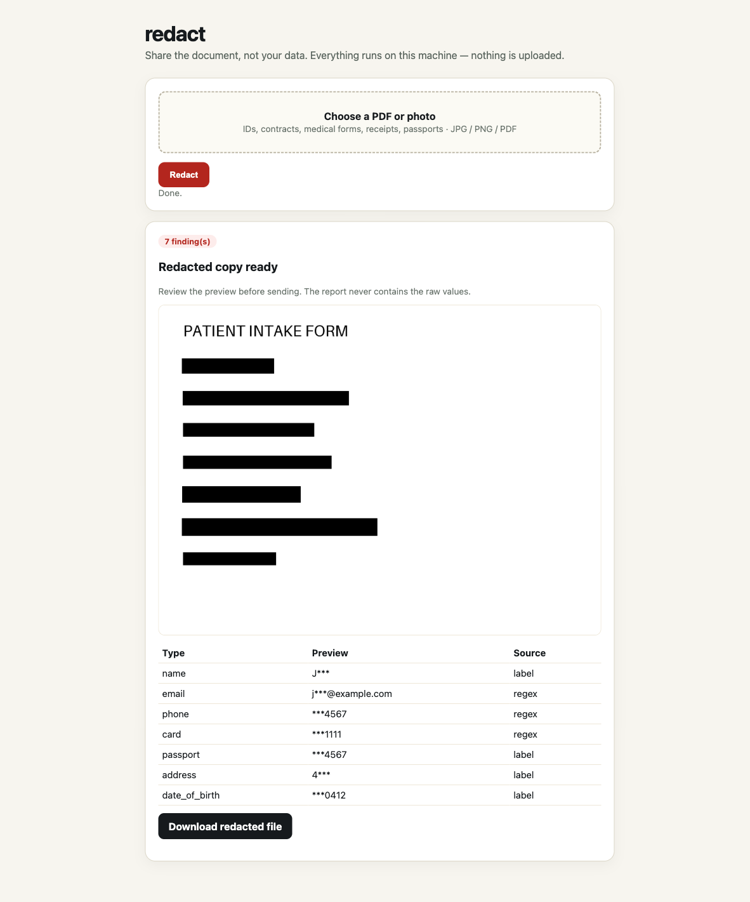

# redact

[](https://github.com/iambiniyam/redact/actions/workflows/ci.yml)
[](LICENSE)

Remove personal information from documents before you share them.

Drop in a PDF or a photo. redact finds emails, phone numbers, card numbers, IBANs, SSNs, names, addresses, passport and ID fields, and faces. It blacks them out and leaves an audit report. The file never leaves your machine.



Status: v0.2.3. RapidOCR is the default fallback. Indra OCR is optional and faster. The output should always be reviewed before it is sent.

## Why

See [how this compares](docs/comparison.md) with the closest tools.

People send passport photos, medical forms, contracts, and receipts over email and chat every day. Many PDF redaction tools upload the original file. Some leave the text underneath the black box, where it can still be copied or searched.

redact keeps the file local. It also flattens PDF pages and clears metadata, so hidden text and annotations do not survive the export.

## What is new in 0.2.0

- Rebuilt interface with drag and drop, paste, a redacted preview, a findings table, and an audit report download.
- Automatic dark mode, keyboard support, loading states, error recovery, and mobile layouts.
- Optional Indra OCR alongside RapidOCR.
- Visible OCR choice and a local-only badge.
- An OCR benchmark that measures speed, confidence, and PII recall.

## What it finds

| Type | Examples | Method |
|---|---|---|
| Email | john.doe@example.com | regex |
| Phone | +1 555 123 4567 | regex and digit count check |
| Card | 4111 1111 1111 1111 | regex and Luhn check |
| IBAN | GB82 WEST 1234 5698 7654 32 | regex and mod-97 check |
| SSN | 123-45-6789 | regex |
| Name, address, date of birth | labeled form fields such as `Name:` and `Address:` | line labels |
| Passport and national ID | labeled fields such as `Passport:` and `ID No:` | line labels |
| Face | portraits and ID photos | YuNet via OpenCV |

## Quickstart

```bash
git clone https://github.com/iambiniyam/redact.git
cd redact
uv venv && source .venv/bin/activate
uv pip install -e ".[dev]"
python scripts/download_models.py
redact scan tests/fixtures/pii_form.png
redact apply tests/fixtures/pii_form.png -o form.redacted.png --report report.json
redact serve
```

The face detector is about 230 KB. The RapidOCR models ship with the wheel.

For the optional Indra backend:

```bash
uv pip install -e ".[indra]"
python scripts/download_models.py --with-indra
redact scan contract.pdf --ocr indra
```

`auto` uses Indra when its models are installed, and RapidOCR otherwise.

## OCR benchmark

A clean synthetic PII form with seven labelled fields. See [docs/evaluation.md](docs/evaluation.md).

| Backend | Mean latency | P95 latency | Confidence | PII recall |
|---|---|---|---|---|
| RapidOCR | 1060 ms | 1201 ms | 0.985 | 1.00 |
| Indra OCR | 248 ms | 457 ms | 0.990 | 1.00 |

Indra is optional because its model weights use an OpenRAIL-M license. RapidOCR is Apache-2.0. The code stays MIT either way.

## CLI

```bash
# detect only, no output file
redact scan contract.pdf

# redact and write a machine-readable audit report
redact apply contract.pdf -o contract.safe.pdf --report audit.json

# skip faces, which is faster and does not need the model
redact apply id.png --no-faces

# choose the OCR engine
redact apply id.png --ocr indra
redact apply id.png --ocr rapidocr
```

## Web UI

`redact serve` opens a local review page with:

- drag and drop, file picker, and paste support
- an OCR engine choice
- a redacted preview before download
- a findings table with type, page, masked preview, source, and confidence
- redacted file and audit report downloads
- loading, empty, and error states
- automatic dark mode and reduced-motion support
- keyboard access and visible focus

The page has no external fonts, scripts, or CDNs.

## How it works

```
PDF or image
  |
  v
render at 200 DPI
  |
  v
RapidOCR or Indra OCR
  |
  +--> regex and labeled fields
  |
  +--> YuNet face detection
  |
  v
black rectangles
  |
  v
rasterized PDF or PNG, plus a masked audit JSON
```

- Digital PDFs use the embedded text layer, which gives accurate boxes.
- Scanned PDFs and images go through the selected OCR backend.
- Faces use YuNet when `scripts/download_models.py` has been run.
- PDF output is rasterized on purpose. The text layer, annotations, and metadata are removed.

## Privacy

- No telemetry, no API keys, and no network calls at runtime.
- Audit reports store masked previews such as `j***@example.com` and `***1111`, plus a digest. They do not store the original value.
- PDFs are flattened and metadata is cleared.
- The scan step keeps the source in `~/.redact/out/jobs` only until you apply the selection, then deletes it. Abandoned jobs are removed after 7 days. Redacted outputs and reports stay in `~/.redact/out` until you delete them.

## Limits

- OCR is not perfect. Rotated, blurred, handwritten, or low-contrast text can be missed.
- Signatures, stamps, and license plates are not detected yet.
- Label-based fields only work when the form uses a label such as `Name:` or `Address:`.
- Faces need the YuNet model. Profile faces and very small faces can be missed.
- Review the redacted file before sharing it. This tool reduces risk. It does not remove all of it.

## Tests

```bash
pytest -q
```

The suite has 14 tests covering detectors, OCR selection, the engine, the PDF pipeline, faces, selected-finding review, and the masked HTML report.

## Roadmap

- signature and stamp detection
- license plate detection
- multilingual NER for names and addresses without labels
- batch mode with a review queue
- side-by-side review with per-finding controls
- a public benchmark that measures recall per PII type

## Related tools

- [snap2sheet](https://github.com/iambiniyam/snap2sheet): receipt and invoice photos to CSV or Excel.
- [find-local](https://github.com/iambiniyam/find-local): offline semantic search for files, PDFs, and photos.
- [shamba](https://github.com/iambiniyam/shamba): offline plant health scanner for gardeners and farmers.

## Contributing

See [CONTRIBUTING.md](CONTRIBUTING.md). For security issues, see [SECURITY.md](SECURITY.md).

## License

MIT. The YuNet face model comes from the OpenCV Zoo and has its own license. Indra OCR is optional and its weights have their own license. See [THIRD_PARTY.md](THIRD_PARTY.md).
